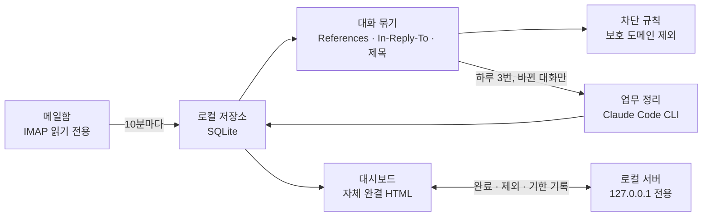

# Mailwork · 메일 업무 비서

**AX 기획 포트폴리오:** [문제 정의·업무 설계·핵심 의사결정 보기](https://jaydensong0401.github.io/emailtask-dashboard/portfolio/)

> **해커톤 제출용 공개 샘플입니다.** 화면과 코드는 실제로 쓰고 있는 버전과 같지만,
> 회사 · 사람 · 메일은 모두 가상으로 바꿨습니다. 실제 메일 · 업무 기록 · 설정 파일은 들어 있지 않고,
> 메일 주소와 도메인은 예시 전용 주소(`.example`)라 실제로 연결되지 않습니다.

**최신 화면과 기능은 [온라인 데모](https://jaydensong0401.github.io/emailtask-dashboard/)에서 확인하세요. 기본 테마는 라이트이며, 화면에서 다크·시스템 테마로 바꿀 수 있습니다.

2026-10-12 운영 UI 반영: 프로젝트 내 일 아님·복구, 남은 업무 우선 정렬, 메일 분류 규칙 페이지, 토큰 절감 보고서. 운영 코드와 같은 화면 생성기를 사용하며, 가상 데이터와 기록 저장 위치만 데모용으로 구성했습니다.

## 풀려는 문제

고객사 · 대행사 · 사내에서 하루 수십 통씩 오는 업무 메일은 대화마다 흩어져 있습니다.
메일함만 봐서는 **지금 내가 할 일**, **내 답을 기다리는 메일**, **프로젝트별 진행 상황**이
한눈에 들어오지 않고, 결정된 내용은 긴 회신 끝에 묻힙니다.

nwmail 은 메일함을 읽어 **대화(스레드) 단위로 묶고**, AI 가 대화 전체를 읽어
**결정사항 · 업무 · 내 할 일 · 기한**을 정리한 뒤, 내 PC 안에서만 열리는 대시보드 하나로 보여줍니다.

## 화면

| 탭 | 보여주는 것 |
|---|---|
| **오늘** | 내가 해야 할 일을 **메일 대화마다 한 줄**로 묶어 보여 줍니다. 기한 있는 일은 '마감 있는 일' 상자에 마감순으로(줄마다 날짜 칩 `9/19 토 · D-1`, 지남 빨강 · 오늘 주황), 나머지는 프로젝트별 상자에. 넓은 화면에서는 왼쪽에 메일 요약, 오른쪽에 내 할 일을 나란히 둡니다. 체크하면 완료, 올리면 제외 · 업무삭제. 아래에 프로젝트별 진행 |
| **답장 대기** | 받는사람(To)에 내가 있는데 아직 답하지 않은 대화. 경과일 · 보낸 사람 · 소속 · 요약 두 줄 · 같은 대화의 할 일 바로가기. 답변완료로 치우거나 삭제할 수 있습니다 |
| **프로젝트** | 맨 위 최근 결정사항 → 진행 중 · 완료 · 삭제 보기 → 고객사 → 세부 프로젝트(머리줄 색 막대를 누르면 색 변경) → 같은 메일명 묶음 → 역할(개발 · 디자인 · 수정 · 기타) 태그가 붙은 할 일 |
| **일정** | 할 일 마감을 월간 달력에 (공휴일 표시). 기한을 직접 정하면 메일에서 뽑은 기한보다 우선 |
| **차단됨** | 광고 · 뉴스레터 · 행사 · 자동 알림 차단 규칙과 차단 후보 제안. 회사 · 주요 고객사 도메인은 어떤 규칙에도 차단되지 않음 |

머리말의 **토큰 사용 현황** 버튼을 누르면 Claude 를 얼마나 썼는지 보여 주는 페이지(`usage.html`)가 열립니다.
오늘 · 최근 7일 · 이번 달 · 누적 토큰과 API 환산 금액, 일별 · 회차별 막대, 용도별 · 프로젝트별 추정,
무거운 대화, 호출 기록(실패 · 한도 초과와 풀리는 시각 포함)을 한 페이지에서 봅니다.

제외한 대화에 내가 **받는사람(To)** 으로 들어간 새 메일이 오면 화면 위에 다시 지목됐다는 알림이 뜹니다.

**프로젝트 색**은 세부 프로젝트마다 다릅니다. `projects.json` 순서대로 9색 팔레트를 차례로 주고, 같은 고객사
안에서는 색이 겹치지 않게 합니다. 프로젝트 머리줄의 색 막대를 누르면 팔레트 색 · 자동 색 · 직접 고른 색
(`#rrggbb`) 중에서 고를 수 있고, 고른 색은 오늘 · 일정 탭에도 바로 반영됩니다. 직접 고른 색은 라이트 ·
다크 테마에 맞게 밝기만 맞춰 씁니다 (`nwmail/colors.py`). 이름이 늘 함께 보이므로 색만으로 구분하지 않습니다.

현재 화면은 온라인 데모에서 직접 확인할 수 있습니다. 이전 스크린샷은 갱신 전 화면일 수 있습니다.

## 동작 구조



- **수집** `sync.py` — 받은메일함의 최근 메일을 받고, 같은 대화의 과거 메일과 내가 보낸 답장까지 찾아 붙입니다.
- **정리** `extract.py` — 대화 전체를 시간순으로 AI 에 넣어 "무엇이 결정됐고 지금 누가 무엇을 해야 하는지"를 뽑습니다.
  이미 정리한 대화는 지난 결과와 그 뒤에 온 메일만 넣어 갱신합니다.
- **화면** `dashboard.py` · `serve.py` — 결과를 오늘·답장 대기·프로젝트·일정·차단됨 대시보드로 만들고, 버튼 기록은 로컬 서버가 저장합니다.
- **자동 실행** `setup_schedule.ps1` — Windows 작업 스케줄러로 10분마다 수집 · 화면 갱신, 9 · 13 · 17시에 업무 정리.

## AI 를 쓰는 방식과 비용

- **대화 단위로 읽는다** — 메일 한 통이 아니라 대화 전체를 봐야 결정이 바뀐 것, 이미 끝난 일을 가려낼 수 있습니다.
  정리 결과는 가장 최근 메일 시점의 현재 상태를 기준으로 합니다.
- **인용은 빼고 넣는다** — 답장마다 붙는 이전 메일 인용(실측 본문의 약 97%)을 걷어내고 새로 쓴 부분만 넣습니다.
- **바뀐 대화만 다시 묻는다** — 대화 내용의 지문(해시)이 같으면 이전 결과를 그대로 씁니다. 여러 대화를 한 번에 묶어 보냅니다.
- **이미 정리한 대화는 새 메일만 보낸다** — 지난 정리 결과와 그 뒤에 온 메일만 넣어 이어서 갱신합니다.
  갱신이 쌓이거나 오래되면 결과에 최근 메일을 붙여 다시 훑어 결론이 어긋나지 않게 합니다.
- **분석에서 뺀 대화는 다시 묻지 않는다** — '제외 → 남의 일' · '업무삭제 → 할 일 아님' 으로 표시한 대화는 이후 정리에서 빠집니다.
  표시를 되돌리면 다음 정리부터 다시 분석합니다.
- **얼마나 썼는지 남긴다** — 호출마다 토큰 · API 환산 금액 · 걸린 시간 · 실패 원인을 기록해 사용 현황 페이지에서 봅니다.
- **정기 보고는 건너뛴다** — 매일 오는 통계 메일처럼 할 일이 거의 없는 대화는 대시보드에만 보이고 정리하지 않습니다.
- **분류는 규칙으로** — 프로젝트 분류(제목 키워드 · 태그 · 발신 도메인)는 화면을 만들 때 규칙으로 다시 정하므로,
  규칙(`projects.json`)을 바꿔도 AI 를 다시 부르지 않습니다.
- **요약 엔진 선택** — `claude_code`(구독 사용량, 추가 과금 없음) · `rules`(LLM 없이 오프라인) · `ollama`(로컬 모델) · `api`(종량 과금).

## 보안 · 개인정보 설계

- **읽기 전용** — IMAP 을 읽기 전용으로 열어 메일을 지우거나 옮기지 않고, 읽음 상태도 바꾸지 않습니다.
- **비밀번호를 파일에 두지 않음** — 외부 앱 비밀번호는 Windows 자격 증명 관리자에 저장합니다.
- **프롬프트 인젝션 방어** — 메일 본문은 신뢰할 수 없는 입력으로 보고, 본문 속 지시문을 따르지 말라고 지시합니다.
- **내 PC 밖으로 나가지 않는 화면** — 대시보드는 외부 리소스를 부르지 않는 단일 HTML 이고, 메일 내용은 전부 이스케이프합니다.
- **로컬 서버 보호** — 127.0.0.1 에서만 열리고, 주소(Host) 검사로 DNS 리바인딩을 막고, 페이지에 심은 토큰이 있어야 기록을 받습니다.
- **보호 도메인** — 회사 · 주요 고객사 도메인은 코드에 고정해 어떤 차단 규칙 · 제안에도 걸리지 않습니다.
- **미리보기 정리** — 인용된 이전 메일, 맺음말 아래 서명 · 연락처 줄을 걷어내고 전화번호를 가립니다.
  웹메일마다 다른 인용 머리말 · 숨은 태그도 함께 처리해 요약 두 줄에 본문만 남깁니다.
- **외부 전송이 안 되는 환경** — `rules` · `ollama` 엔진을 쓰면 메일 본문이 PC 밖으로 나가지 않습니다.

## 데모

**온라인 데모: https://jaydensong0401.github.io/emailtask-dashboard/**

서버 없이 브라우저 안에서 동작합니다. 완료 · 제외 · 업무삭제 · 기한 · 답변완료 버튼 기록은 방문자 브라우저에만
저장되고, 화면 위 안내줄의 **처음 상태로** 로 되돌릴 수 있습니다. 온라인 데모는 완료·제외·프로젝트 내 일 아님·기한·답변완료·색 변경을 지원합니다. 차단 규칙 변경과 그에 따른 메일 재분류는 동일한 운영 코드를 쓰는 로컬 데모 서버에서 지원합니다.
데모는 실제 메일함에 접속하지 않고 AI 도 부르지 않습니다 (정리 결과와 토큰 사용 기록은 `demo/build_demo.py` 에 미리 써 두었습니다).
머리말의 **메일 분류 규칙** 버튼으로 규칙 페이지도 확인할 수 있습니다. **토큰 사용 현황** 버튼으로 [사용 현황 페이지](https://jaydensong0401.github.io/emailtask-dashboard/usage.html)도 열어 볼 수 있습니다.
프로젝트 머리줄의 색 막대로 색을 바꾸는 것도 온라인 데모에서 그대로 동작합니다 (기록은 방문자 브라우저에만).

직접 만들어 보려면 Python 3.10 이상이 필요합니다 (3.12 에서 확인).

```bash
pip install -r requirements.txt
```

```bash
python demo/build_demo.py
```

`docs/index.html` 과 `docs/usage.html` 이 만들어집니다 (온라인 데모와 같은 페이지, 파일로 열어도 버튼이 동작합니다).
기록을 서버에 저장하고 차단 규칙까지 바꿔 보려면 데모 서버를 켭니다.

```bash
python demo/serve_demo.py
```

http://127.0.0.1:8790/ 로 열면 됩니다. 기록은 `demo/` 안의 데모 DB 에만 저장되고, 처음 상태로 되돌리려면
`python demo/serve_demo.py --reset` 을 씁니다.

## 클라우드 데모 (선택 · Google Cloud Run)

온라인 데모는 GitHub Pages 로 충분합니다. 서버째 올리고 싶을 때만 씁니다. Cloud Run 은 매달 무료 사용량이 있지만,
넘는 사용량(이미지 보관 · 데이터 전송 등)은 과금될 수 있습니다.

저장소 루트의 `Dockerfile` 로 빌드합니다. 컨테이너는 `python demo/serve_demo.py --cloud` 로 켜지고,
켤 때마다 데모 데이터를 처음 상태로 만듭니다. 방문자는 같은 데모 기록을 함께 보고, 서버가 쉬었다가
다시 켜지면 처음 상태로 돌아갑니다.

1. Cloud Run → **서비스 만들기** → **저장소에서 지속적으로 배포** → Cloud Build 설정에서 이 GitHub 저장소를 연결하고, 빌드 유형은 **Dockerfile**
2. 서비스 이름(주소 앞부분이 됩니다), 리전 `asia-northeast3`(서울), 인증 **인증되지 않은 호출 허용**, 최대 인스턴스 **1**
3. 만든 뒤 화면에 나오는 서비스 주소의 호스트 이름을 환경변수 `DEMO_HOSTS` 에 넣고 새 버전을 배포합니다.
   주소가 두 개로 보이면 쉼표로 둘 다 적습니다. 예: `DEMO_HOSTS=nwmail-demo-123456789.asia-northeast3.run.app`

서버는 로컬용과 같은 주소(Host) 검사를 하고, `DEMO_HOSTS` 에 적은 주소만 더 받습니다.

## 테스트

실제 메일함 · AI 없이 합성 데이터로 끝까지 검증합니다. 12개 스위트, 779개 항목이 통과합니다.

```bash
python test_dashboard.py
```

`test_store.py` · `test_context.py` · `test_extract.py` · `test_filters.py` · `test_server.py` · `test_auto.py` ·
`test_usage.py` · `test_exclusions.py` · `test_tasklinks.py` · `test_project_progress.py` 도 같은 방식으로 실행합니다.
`test_feasibility.py` 는 네이버웍스 서버에 실제로 접속해 보는 연결 점검이라 따로 실행합니다.

## 실제 메일함에 연결하려면

1. `.env.example` 을 `.env` 로 복사하고 메일 주소를 적습니다 (네이버웍스 IMAP, 관리자가 IMAP 을 허용해야 합니다).
2. `python set_password.py` — 외부 앱 비밀번호를 Windows 자격 증명 관리자에 저장합니다.
3. `python sync.py` → `python extract.py` → `python dashboard.py --open`
4. 자동 실행: `pwsh -ExecutionPolicy Bypass -File setup_schedule.ps1`

진단이 필요하면 `python run.py --doctor` 가 막힌 지점과 해결책을 알려줍니다.

## 폴더 구조

```
nwmail/            핵심 모듈 (수집 · 저장 · 대화 묶기 · 정리 · 대시보드 · 로컬 서버 · 차단 · 토큰 기록 · 색)
nwmail/assets/     대시보드 머리말 로고(SVG)
demo/              데모 데이터 생성 · 데모 서버 · 서버 없이 여는 페이지용 API 대역(demo_api.js)
docs/              온라인 데모 페이지(index.html · usage.html, GitHub Pages) · README 화면(screenshots/)
projects.json      프로젝트 식별 규칙 (고객사 > 세부 프로젝트 > 제목 키워드, 별칭, 도메인)
sync.py · extract.py · dashboard.py · serve.py · auto.py   실행 스크립트
test_*.py          검증 스위트
```

## 이 공개본에 대해

- 실제로 쓰고 있는 버전에서 회사 · 사람 · 프로젝트 이름, 메일 제목 · 주소를 일관된 가명으로 바꾼 사본입니다.
  치환은 코드 · 설정 · 테스트에 똑같이 적용했고, 치환 후에도 테스트가 모두 통과합니다.
- 실제 메일 DB · 업무 기록 · `.env` · 인증서 · git 이력은 포함하지 않습니다.
- 실제 메일 DB 에서 뽑은 주소 · 도메인 · 이름 · 제목 조각과 이 저장소의 모든 파일을 대조해 겹치는 것이 없음을 확인했습니다.
